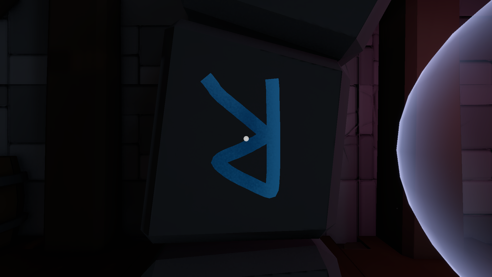
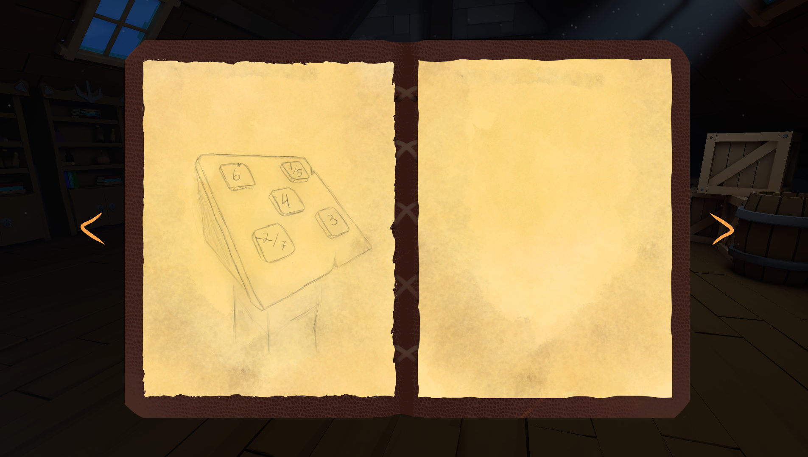
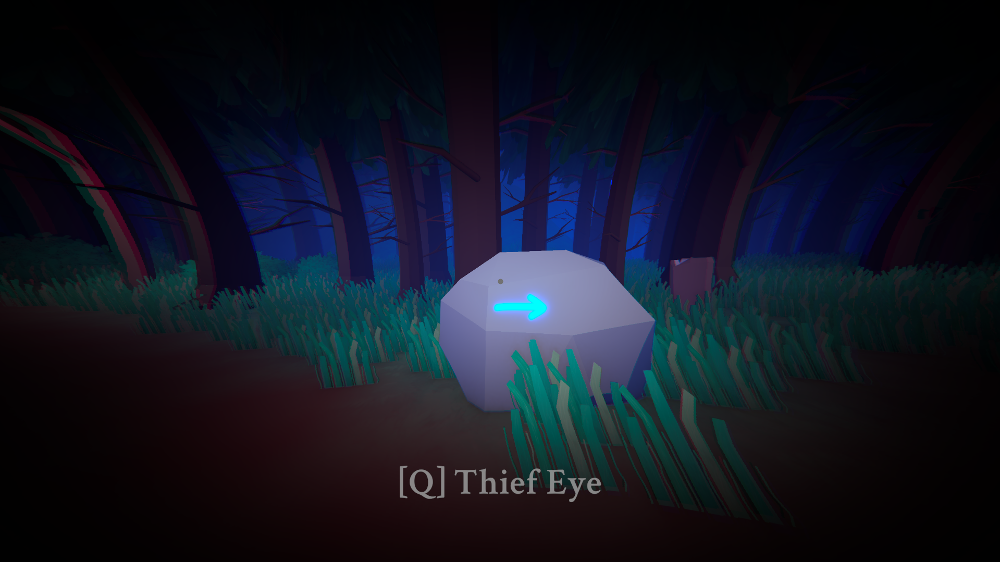

# The Manor's Heart

* **Поиграть на Itch.io:** [ciretrus.itch.io/the-manors-heart](https://ciretrus.itch.io/the-manors-heart)
* **Проект XLab Game Dev School (CarX Technologies):** [Страница проекта на XLab](https://xlab-game.com/group0425/themanorsheart)
* **Разработка:** Indie-команда **QuadroA** (4 человека)

---

## Ключевые решения системного и технического GD

### 1. Механика рисования рун и распознавание жестов ($1 Unistroke Recognizer)
В классических квестах ввод символов часто сводится к банальному нажатию кнопок или подбору цифр. Чтобы усилить погружение и передать ощущение прямого контакта с магией древнего поместья, была реализована механика **свободного начертания рун игроком**.

* **Как решено:**
  * Интеракция построена через систему рисования (`DrawingController`, `DrawableLine`, `DrawCanvas`): при взаимодействии с рунным монолитом камера центрируется на рабочей плоскости, а мышь переводится в режим рисования штриха в реальном времени.
  * Распознавание символа реализовано на базе чистого геометрического алгоритма **$1 Unistroke Recognizer** (`UnistrokeRecognizer`):
    1. **Ресемплинг (`Resample`):** произвольная кривая нормализуется до фиксированного числа равноудалённых точек (64 контрольные точки), нивелируя разницу в скорости движения мыши и частоте кадров.
    2. **Масштабирование (`ScaleToSquare`):** жест вписывается в эталонный квадрат, делая алгоритм нечувствительным к размеру нарисованного символа.
    3. **Центрирование (`TranslateToOrigin`):** вычисляется центроид (центр масс) набора точек, и весь рисунок смещается в начало координат `(0, 0)`, обеспечивая инвариантность к положению курсора на плоскости.
    4. **Сравнение (`GetDistanceBetweenDraws`):** алгоритм суммирует евклидовы расстояния между нормализованными точками штриха игрока и эталонными шаблонами (`DrawingData`), определяя наиболее близкую руну.
* **Результат:** 
  * Игрок может рисовать руны естественным движением руки любого размера и в любой части интерактивной зоны.
  * Алгоритм работает мгновенно и без тяжелых сторонних ML-библиотек, обеспечивая надежную валидацию даже при неидеальном вводе. Ошибки ввода сопровождаются реакцией окружения (партиклы `m_flashParticleSystem` и аудио-фидбек).

---

### 2. Дневник исследователя: Diegetic UI и архитектура подсказок
Для escape-room игры критически важно избегать искусственных маркеров интерфейса и «ведения за ручку», сохраняя чувство личного триумфа при самостоятельном решении загадок.

* **Подход к коду и дизайну:**
  * Дневник (`Diary`) выполнен как **диегетический (внутриигровой) инструмент**: зарисовки и заметки стилизованы под страницы полевого журнала исследователя с процедурным добавлением разворотов (`AddSpread`) и навигацией по страницам.
  * Добавление заметок изолировано и автоматизировано: интерактивные объекты в мире (`DiaryInteractable`) через `ServiceLocator` передают в журнал страницу и спрайт (`SetPage`), предотвращая дублирование записей.
  * Нотификация о новой записи сделана ненавязчиво через микро-анимацию затухания и появления с помощью **DOTween** (`DiaryNotificationSystem`).
* **Влияние на геймплей:**
  * Вместо прямых текстовых инструкций используется язык визуальных схем и пропорций (например, зарисовки постаментов с дробными соотношениями `1/5`, `2/7`).
  * Дневник работает в связке с модульной системой головоломок (`BasePuzzle`), связывая подсказки из разных комнат в единое исследовательское пространство.

---

### 3. Способность «Глаз вора» (Thief's Eye): скрытый слой и переключение восприятия
Чтобы разнообразить исследование локаций и скрыть тайные знаки в открытых пространствах поместья, была спроектирована способность **«Глаз вора»** — кратковременный мистический режим видения, проявляющий скрытые ориентиры и подсказки.

* **Как решено:**
  * Логика способности инкапсулирована в `ThiefEye`. При нажатии клавиши активации запускается корутина `CastThiefEyeSkill` с таймером действия (`m_durationTime = 3f`).
  * **Манипуляция слоями камеры:** скрытые подсказки и стрелки помещены на отдельный `LayerMask` (`m_layerThiefEye`). В обычном состоянии они отсечены камерой, а при активации подмешиваются в маску отсечения (`m_camera.cullingMask |= m_layerThiefEye`), что исключает лишние проверки в рантайме.
  * **Двойной пост-процессинг:** камера переключается между двумя профилями `Volume` (стандартным `m_standardVolume` и мистическим `m_thiefEyeVolume`). Веса интерполируются плавно за время активации (`m_activationTime`), создавая эффект погружения в астральный спектр с виньетированием.
